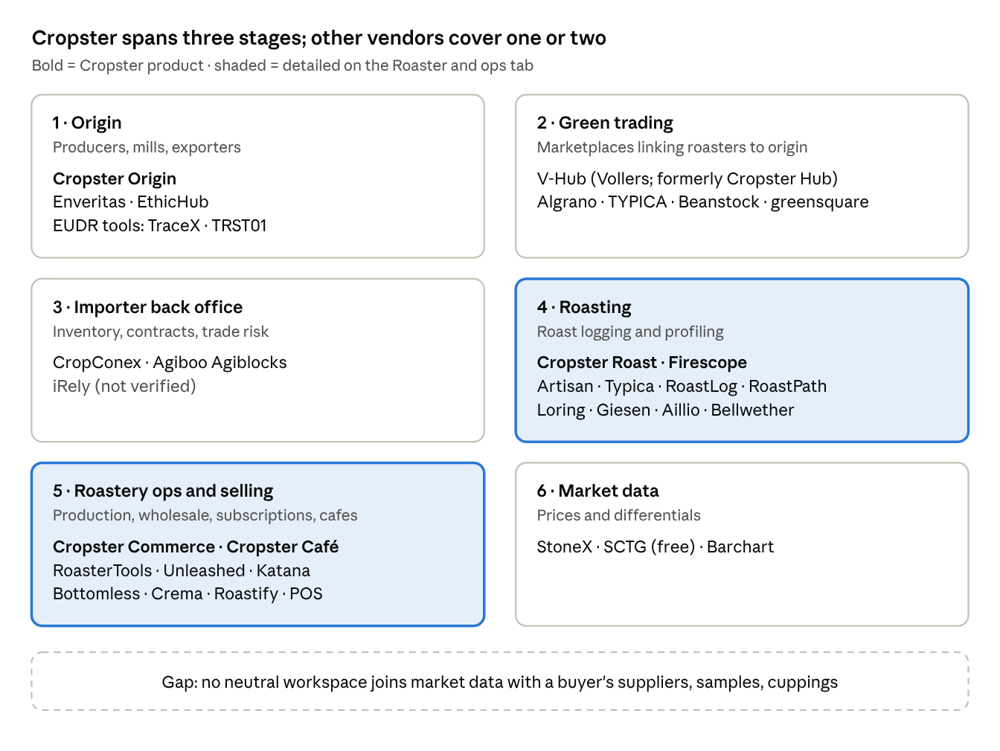

# Specialty Coffee Software Market Map

As of 2026-10-19. Living version (editable, shareable): https://claude.ai/code/artifact/2c0a3a10-a6e6-4f41-a0d2-8f69d67f35bc
Deep dive on roastery tools: [roaster-and-ops-software.md](roaster-and-ops-software.md)

## Summary

Specialty coffee software splits into six stages: origin, green trading, importer back office, roasting, roastery operations, and market data. Cropster covers the most stages: origin, roasting and roastery operations. It is PE-backed (Verdane took a majority stake in 2024) and is buying competitors: it acquired Asia's Firescope (3,000+ small roasters) in October 2025 and says more deals are coming.

- **Marketplaces** (Algrano, TYPICA, V-Hub, Beanstock, greensquare) show only their own listings.
- **Back-office tools** (CropConex, Agiboo) serve sellers and large traders, not independent buyers.
- **Roastery tools** (Cropster Roast, RoasterTools, Artisan, software from roaster makers) start only after the coffee is bought.
- **Price context** is either paywalled (StoneX, $200/month) or published once a year (the free Specialty Coffee Transaction Guide).

The open gap: a neutral workspace where an independent buyer or broker combines market data with their own suppliers, samples and cuppings.

## Market map

Stages run from the farm (1) to price data (6). Cropster sells into three of the six; the other vendors are mostly single-stage.

## Companies by stage

Roasting and roastery-operations tools are in [roaster-and-ops-software.md](roaster-and-ops-software.md); this table covers everything else.

| Company | Stage | Who it's for | Model / pricing | What stands out |
| --- | --- | --- | --- | --- |
| [Cropster Origin](https://www.cropster.com/products/origin/) | Origin | Producers, mills, exporters | From 199 €/month + usage; Enterprise by quote | Lot, processing and inventory records; mobile cupping |
| [Enveritas](https://enveritas.org/) | Origin | Roasters' sourcing teams | Non-profit; buyers pay for the audit | 350k+ farms verified; EUDR portal; partners include JDE Peet's and Counter Culture |
| [EthicHub](https://ethichub.com/) | Origin | Smallholders, lenders, roasters | Crowdlending + coffee sales | Claims 10k+ Latin American farmers and 300+ t sold (self-reported) |
| [TraceX](https://tracextech.com/), [TRST01](https://www.trst01.com/) | Origin | Exporters, EU importers | SaaS | EUDR due-diligence tools; a crowded, fast-growing niche |
| [Algrano](https://algrano.com/) | Green trading | EU/US roasters, producers | Commission via exporters/importers | Direct producer profiles; shared shipments from a single 60-kg bag; shipping, financing and warehousing services |
| [TYPICA](https://typica.coffee/en/) | Green trading | Roasters in 40 countries, producers in 36 | Platform fee shown openly | Producers set their own prices; one-bag minimum; started in Asia |
| [V-Hub](https://www.v-hub.vollers.com/) (formerly Cropster Hub) | Green trading | Roasters | Virtual broker; fees not public | Owned by logistics group Vollers since Aug 2021; lots at origin and in transit; remote auctions |
| [Beanstock](https://www.beanstock.ag/) | Green trading | US roasters | Not stated | Combines importers' US spot lists; sample requests to several importers at once; launched 2016, current status unconfirmed |
| greensquare (website not confirmed) | Green trading | Australian roasters, traders | Not stated | Spot + forward contracts, digital signing, drawdowns |
| [CropConex](https://www.cropconex.com/) | Importer back office | US importers, roasters | Tiered subscription | Lot inventory, curated offers, contracts, fulfilment |
| [Agiboo Agiblocks](https://www.agiboo.com/) | Importer back office | Mid-size to large traders | Enterprise trade and risk management software (CTRM) | Coffee differentials, sampling, quality and weight tolerance rules |
| [StoneX Differential Insights](https://shop.stonex.com/products/coffee-differential-insight) | Market data | Traders, roasters | $200/month or $2,040/year | Weekly FOB differentials by origin; Brazil internal prices |
| [Specialty Coffee Transaction Guide](https://www.transactionguide.coffee/) | Market data | Whole chain | Free, annual | FOB medians from 100k+ contracts by quality, lot size and origin |

Not checked this pass: iRely (a commodity ERP some coffee traders use) and farmer connect / iFinca (traceability aimed at consumers).

## Gaps for independent and specialty operators

- **No neutral buyer workspace.** Marketplaces show their own lots, and nobody combines a buyer's suppliers, samples and cuppings with live market data.
- **Price context is expensive.** Weekly differentials cost $2,040/year; the free benchmark comes out once a year.
- **Sourcing and roasting don't talk.** Green purchases are re-typed into roast software; artisan.plus syncs with only three importers.
- **Consolidation risk.** Cropster is buying competitors, so independents may want a vendor-neutral option.
- **Offline field work is under-served.** Few tools are built for farm visits with no signal.

## Where to read more

Generic startup lists are mostly consumer coffee brands and machines; trade press is a better source.

| Source | Type | Why read it |
| --- | --- | --- |
| [Daily Coffee News](https://dailycoffeenews.com/2025/12/26/2025-year-in-review-new-coffee-roasting-equipment-and-tech/) | Trade press | Yearly roasting equipment and tech roundup; vendor launches |
| [Perfect Daily Grind](https://perfectdailygrind.com/2025/10/how-technology-is-changing-in-coffee/) | Trade press | Tech explainers (Cropster is a sponsor) |
| [Global Coffee Report](https://www.gcrmag.com/verdane-acquires-majority-stake-in-cropster) | Trade press | Deals and funding |
| [World Coffee Portal](https://worldcoffeeportal.com/Latest/InsightAnalysis/2024/May/Enveritas-big-idea-for-coffee-sustainability) | Trade press | Industry analysis |
| [Tea & Coffee Trade Journal](https://www.teaandcoffee.net/news/37938/cropster-acquires-firescope/) | Trade press | Acquisitions and supply-chain news |
| [Fresh Cup](https://freshcup.com/online-green-coffee-sourcing/) | Trade press | Guide to online green-coffee sourcing platforms |
| [BeanScene](https://www.beanscenemag.com.au/how-greensquare-is-a-digitalised-solution-for-roasting-businesses) | Trade press | Australia and Asia-Pacific |
| [VCBacked coffee directory](https://www.vcbacked.co/directory/industries/coffee) | Startup database | 128 funded companies; filter out consumer brands |
| [Seedtable](https://seedtable.com/best-coffee-startups) | Startup database | Ranked list, mostly consumer |
| Crunchbase, Tracxn, Dealroom, [CB Insights](https://www.cbinsights.com/company/agiboo) | Startup database | Search "coffee" + "supply chain", "SaaS", "traceability" |
| [The Spoon](https://thespoon.tech/tag/bellwether-coffee), AgFunder News | Food and agri-tech press | Funding rounds |
| [StartUs Insights](https://www.startus-insights.com/innovators-guide/discover-5-top-coffee-bean-sourcing-technologies-developed-by-startups/) | Startup scouting | Roundups of sourcing-tech startups |
| [Lavazza Brewing Connection](https://www.lavazzagroup.com/en/brewing-connection.html), [Avança Café](https://centev.ufv.br/en/servico/avanca-cafe-advance-coffee/) | Accelerators | Early-stage entrants (Avança Café picked 26 startups) |
| SCA Specialty Coffee Expo, World of Coffee | Events | Best New Product awards; software exhibitors |

## Sources

Company names link to their own websites; facts come from these pages, opened 19 Oct 2026: [Cropster Origin pricing](https://www.cropster.com/packages/) · [Verdane stake in Cropster, GCR](https://www.gcrmag.com/verdane-acquires-majority-stake-in-cropster) · [Cropster acquires Firescope, T&CTJ](https://www.teaandcoffee.net/news/37938/cropster-acquires-firescope/) · [Enveritas, World Coffee Portal](https://worldcoffeeportal.com/Latest/InsightAnalysis/2024/May/Enveritas-big-idea-for-coffee-sustainability) · [EthicHub release](https://www.aap.com.au/aapreleases/cision20250725ae37669) · [TraceX EUDR coffee](https://tracextech.com/eudr-dds/coffee-supply-chain-uk/) · [TRST01 EUDR release](https://www.outlookbusiness.com/spotlight/pr-wire/trst01-announces-full-eudr-readiness-for-indian-coffee-rubber-and-soy-exporters-as-30-december-deadline-nears) · [Algrano US launch, DCN](https://dailycoffeenews.com/2023/04/10/direct-trade-green-coffee-platform-algrano-makes-us-launch) · [TYPICA, Japan Kizuna](https://www.japan.go.jp/kizuna/2024/08/online_coffee_trading_platform.html) · [Online green sourcing, Fresh Cup](https://freshcup.com/online-green-coffee-sourcing/) · [Vollers buys Cropster Hub](https://www.vollers.com/news/details/green-coffee-marketplace-with-a-future-logistics-company-vollers-group-purchases-green-coffee-marketplace-cropster-hub) · [Beanstock launch, DCN](https://dailycoffeenews.com/2016/06/02/green-coffee-aggregator-beanstock-makes-official-launch-following-scaa-success) · [greensquare, BeanScene](https://www.beanscenemag.com.au/how-greensquare-is-a-digitalised-solution-for-roasting-businesses) · [CropConex tools, Sprudge](https://sprudge.com/cropconex-unveils-new-suite-of-tools-for-coffee-traders-224294.html) · [Agiblocks for coffee](https://www.agiboo.com/specialized-commodities-coffee/) · [StoneX Differential Insights](https://shop.stonex.com/products/coffee-differential-insight) · [2024 SCTG, DCN](https://dailycoffeenews.com/2025/02/18/the-2024-specialty-coffee-transaction-guide-is-here)
